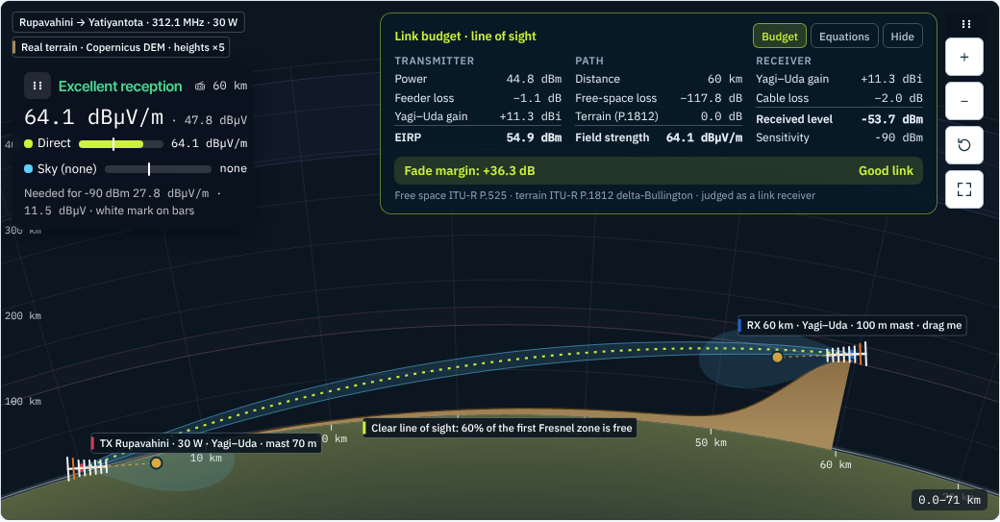
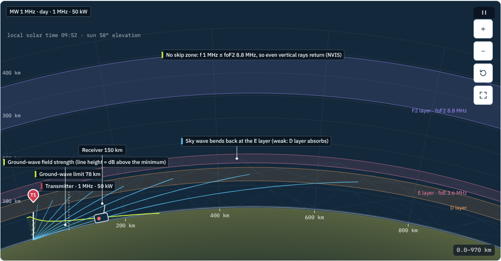

# Groundwave Propagation Lab

**An interactive radio propagation laboratory and digital shadow for teaching wireless communication.**

Live site: **https://groundwave-lab.pages.dev**

Students meet radio propagation as equations. This lab lets them see those equations at work on real maps and terrain, and then compare them with measurements. The prediction side uses ITU-R methods from LF to UHF. The measurement side accepts readings from a MATLAB simulator, a smartphone or a software-defined radio. The difference between the two is where most of the learning happens.

The lab runs entirely in the browser. There is nothing to install and no licence to buy.



## What you can do with it

**Explore propagation**
- Ground wave, sky wave, line of sight, ground reflection, refraction and diffraction, each animated over a curved earth, with the live maths beside it.
- An *Engineering* display style for clean figures and a *Teaching* style for the classroom.
- Coverage on a real map, with terrain from the Copernicus DEM and buildings from OpenStreetMap.
- A terrain profile with the Fresnel zone, a selectable k-factor and the ITU-R P.530 clearance check.



**Design a link**
- Transmitters, relays and receivers, with 11 antenna types and their patterns. Drag a beam to aim or tilt it.
- A link budget: EIRP, path loss, received level and fade margin.
- Receivers judged either as broadcast listeners or as link receivers.
- Calculators for cable loss, receiver sensitivity, P.530 availability and location variability.

**Compare with reality (digital shadow)**
- Readings arrive through a small HTTP interface (`/api/measure`) from any source.
- The lab compares each reading with the equation-only prediction, maps the error and calibrates the model. It fits offset, building loss, indoor loss and distance trend, and tests on points kept aside.
- Live weather (refractivity, rain, soil moisture) and space weather can feed the model.

**Teach and assess**
- Virtual-laboratory experiments (Aim, Theory, Procedure, Simulation, Observation, Test): skip distance, two-ray interference, knife-edge diffraction, fading, calibration and smartphone 4G measurements.
- Lessons, a quiz, a guided tour, and every equation shown step by step in the Models tab.

## Standards and models

| Topic | Method |
|---|---|
| Ground wave, LF/MF | ITU-R P.368 (GRWAVE method), Millington mixed paths |
| Sky wave | ITU-R P.1147 (MF); P.533-style geometry (HF) |
| VHF/UHF over terrain | ITU-R P.1812-6 with delta-Bullington diffraction (P.526), clutter (P.2108), building entry (P.2109) |
| Point-to-point links | ITU-R P.525 link budget, P.530-18 clearance and availability |
| Atmosphere and rain | ITU-R P.453, P.834 (refractivity, k-factor), P.838 (rain) |
| Cellular | Hata (P.529), M.2412, 3GPP RSRP conversion (TS 36.214) |

**Verification.** The P.1812 implementation reproduces the 19 official ITU-R P.1812-6 validation profiles within 0.003 dB of the ITU-R reference implementation. You can run this check yourself in **Models → Verification**.

## Getting started

**Use it online:** open https://groundwave-lab.pages.dev. The **Guide** button gives a one-minute tour.

**Run it on your own computer:** `index.html` opens directly in a browser. For the live measurement link you need a host that runs the functions in `functions/api/`, such as Cloudflare Pages. [SETUP.md](SETUP.md) explains deployment step by step.

## Connecting a sensor

Any program can send readings with one HTTP request:

```bash
curl -X POST "https://groundwave-lab.pages.dev/api/measure?ch=my-lab" \
  -H "Content-Type: application/json" \
  -d '{"readings":[{"sensor":"S1","lat":6.8840,"lon":79.8850,"level":85.3,"f_mhz":433,"h":1.5}]}'
```

Then open **Shadow → Live data**, enter the channel `my-lab` and press **Connect**. `level` is the field strength in dBµV/m. Ready-made senders are in `assets/`:

| Script | What it does |
|---|---|
| `wisdom_sensor_emulator.m` | MATLAB/Octave sensor that streams simulated readings |
| `wisdom_experiments.m` | MATLAB/Octave experiments: sensor model, batch calibration, results and plots |
| `wisdom_phone_live.sh` | Android (Termux) script that streams the phone's 4G signal and GPS |

## Repository layout

| Path | Contents |
|---|---|
| `index.html` | The whole application: models, map, animation, digital shadow, lessons |
| `functions/api/` | Server functions: `measure.js` (sensor readings), `feedback.js`, `visits.js` |
| `feedback.html` | Staff inbox for student feedback |
| `assets/` | Icons, images, equation fonts, ITU-R validation data, sensor scripts |
| `_headers` | Security and caching settings for Cloudflare Pages |
| [`SETUP.md`](SETUP.md) | Deployment and storage setup |
| [`CHANGELOG.md`](CHANGELOG.md) | What changed in each version |
| [`docs/DEVELOPMENT.md`](docs/DEVELOPMENT.md) | Design tokens and a usability-test protocol |

## Limitations

The lab is a teaching tool and a first-cut planning aid, not a licensing tool.
- P.1812 is implemented for 50 % of the time only.
- Building heights from OpenStreetMap are often estimated from the number of floors.
- Live weather comes from a numerical model, not from measurements at the site.

For licensing and detailed planning, use the full ITU-R methods or professional planning software.

## Data and credits

- Maps: © OpenStreetMap contributors, CARTO, OpenTopoMap.
- Terrain: Copernicus DEM GLO-90 via Open-Meteo.
- Weather: Open-Meteo. Space weather: NOAA SWPC.
- ITU-R P.1812-6 validation data: I. Stevanovic, *MATLAB/Octave implementation of Recommendation ITU-R P.1812-6*, doi:10.5281/zenodo.6141558.
- Equations typeset with KaTeX (MIT licence).

The free map and terrain services have fair-use policies; see [SETUP.md](SETUP.md).

## Development

The lab was designed and directed by the project team and developed with the help of an AI coding assistant (Claude, Anthropic). Every model was checked against ITU-R references, and every change was reviewed and tested before release.
